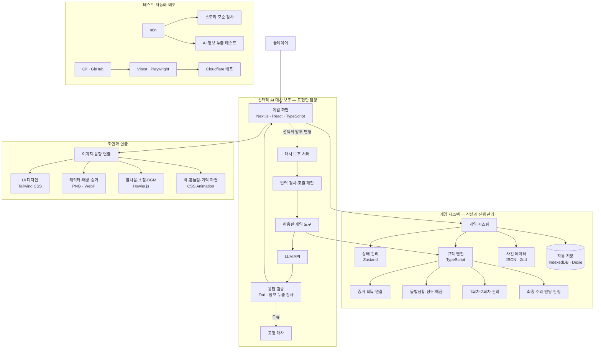
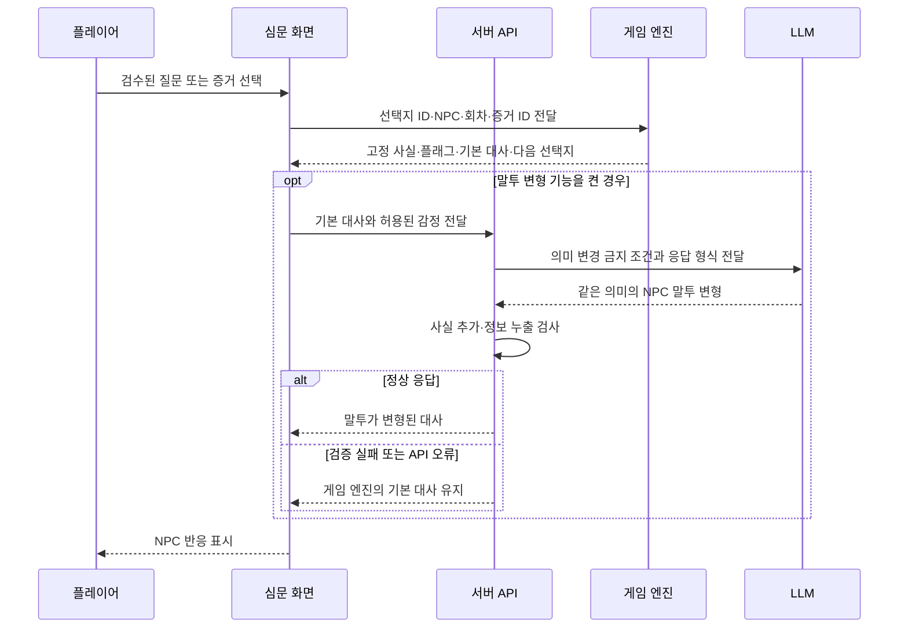

# 《마지막 객실의 탐정》 기술 구조도

> 2026-11-24 선택형 시나리오 정본 기준. 현재 단계에서는 구조 문서만 갱신하며 실제 게임 코드는 수정하지 않는다.

> 19세기 런던행 열차에서 벌어지는 사건을 조사하고, 1회차와 2회차에서 같은 증거를 다르게 해석하는 AI 추리게임

---

## 1. 한눈에 보는 핵심 구조

이 프로젝트는 기술을 세 부분으로 나눈다.

| 구분 | 담당하는 일 | 핵심 기술 |
|---|---|---|
| **게임 시스템** | 사건 진상, 증거, 시간표, 회차, 엔딩 판정 | TypeScript, JSON, Zod, Zustand |
| **선택형 NPC** | 고정 질문·증거 반응·표정 해금, 선택적 말투 변형 | TypeScript 데이터, 상태 머신, 선택적 LLM API |
| **운영·검수** | 모순 검사, 반복 테스트, 파일 관리 | n8n, Vitest, Playwright |

### 가장 중요한 원칙

> **게임 엔진이 진실을 결정하고, AI는 그 진실을 NPC답게 말한다.**

AI는 새로운 범인이나 증거를 만들 수 없다. 범인, 사건 시간표, 증거 획득 조건과 엔딩은 항상 규칙 기반 게임 엔진이 관리한다.

---

## 2. 전체 기술 구조도



---

## 3. 기술 선택 요약

### 현재 프로젝트에 적용된 기술

| 기술 | 역할 |
|---|---|
| **Next.js 16** | 화면, 라우팅, 서버 API 구성 |
| **React 19** | 게임 UI와 컴포넌트 제작 |
| **TypeScript** | 사건 데이터와 게임 상태의 오류 방지 |
| **Tailwind CSS 4** | 19세기 런던풍 UI와 반응형 디자인 |
| **Vite · vinext** | 빠른 개발 환경과 빌드 |
| **Wrangler · Cloudflare 도구** | 웹게임 배포 기반 |
| **ESLint** | 코드 품질 검사 |

### MVP에 추가할 필수 기술

| 기술 | 사용할 기능 | 필요한 이유 |
|---|---|---|
| **Zustand** | 현재 장소, 증거, NPC, 회차 상태 | 여러 화면에서 같은 게임 상태를 사용하기 위해 |
| **Zod** | JSON 데이터와 AI 응답 검사 | 잘못된 데이터와 AI 출력 오류를 차단하기 위해 |
| **IndexedDB · Dexie** | 자동 저장, 이어하기, 2회차 해금 | 새로고침 후에도 진행 상황을 보존하기 위해 |
| **Howler.js** | 열차음, 초침, 정전, BGM | 장면별 음향을 안정적으로 제어하기 위해 |
| **Vitest** | 증거·트리거·엔딩 단위 테스트 | 도달할 수 없는 엔딩과 조건 오류를 찾기 위해 |
| **Playwright** | 실제 브라우저 전체 진행 테스트 | 시작부터 엔딩까지 흐름을 검증하기 위해 |

### 추후 확장 기술

| 기술 | 확장 기능 |
|---|---|
| **Cloudflare D1** | 로그인과 기기 간 저장 동기화 |
| **Cloudflare R2** | 대용량 이미지·음향 파일 저장 |
| **익명 분석 로그** | 이탈 구간, 힌트 사용률, 엔딩 도달률 확인 |
| **PWA** | 웹게임 설치와 오프라인 일부 지원 |

---

## 4. 게임 데이터와 AI의 역할 분리

### 게임 시스템이 결정하는 것

- 실제 범인과 사건의 진상
- 사건 발생 전후 시간표
- NPC가 실제로 한 행동
- 증거가 놓인 위치와 획득 조건
- 돌발 상황 발생 조건
- 1회차와 2회차 해금 조건
- 최종 추리의 정답과 엔딩

### AI가 담당하는 것

- 플레이어 질문의 의도 파악
- NPC별 말투와 성격 표현
- 현재 감정 상태 표현
- 허용된 사실의 자연스러운 설명
- 설정된 거짓말, 회피와 침묵 표현
- 제시된 증거에 대한 반응

### AI가 해서는 안 되는 것

- 새로운 범인이나 용의자 생성
- 존재하지 않는 증거 추가
- 사건 시간표 변경
- NPC가 모르는 정보 공개
- 해금 전 단서 노출
- 엔딩 전에 진범 직접 공개

---

## 5. 선택형 NPC 대화 처리 과정



### AI API 장애에 대비하는 방법

AI가 작동하지 않아도 게임을 끝낼 수 있어야 한다.

1. NPC마다 핵심 질문에 대한 고정 대사를 준비한다.
2. AI 오류 시 고정 대사 또는 재질문 안내를 보여준다.
3. 증거 획득과 엔딩 판정은 AI 응답에 의존하지 않는다.
4. API 키는 브라우저가 아닌 서버 환경 변수에 저장한다.

---

## 6. 핵심 데이터 구조

```text
caseData
├─ meta                 사건 제목, 시대, 제한 시간
├─ truth                실제 진상과 고정 시간표
├─ runs                 회차별 공개 범위
├─ locations            객실과 조사 오브젝트
├─ npcs
│  ├─ persona           성격, 말투, 인물 관계
│  ├─ knownFacts        알고 있는 사실
│  ├─ lies              숨기거나 왜곡하는 내용
│  └─ evidenceReactions 증거별 반응
├─ evidence
│  ├─ acquireCondition  획득 조건
│  ├─ run1Meaning       1회차 해석
│  └─ run2Meaning       2회차 해석
├─ triggers             정전, 심문 중단, 기억 해금
├─ memories             증거 조합으로 열리는 기억
└─ endings              최종 추리와 엔딩 조건

saveState
├─ currentRun           현재 회차
├─ currentScene         현재 장면
├─ elapsedGameTime      게임 속 경과 시간
├─ evidenceIds          수집한 증거
├─ unlockedLocations    열린 장소
├─ askedTopics          질문한 주제
├─ npcStates            NPC별 감정과 대화 상태
├─ memoryIds            해금된 기억
└─ endingIds            도달한 엔딩
```

---

## 7. n8n의 역할

### n8n을 사용하면 좋은 부분

| 자동화 | 내용 |
|---|---|
| **사건 데이터 검사** | 존재하지 않는 증거 ID와 NPC 참조 탐지 |
| **엔딩 도달 검사** | 각 엔딩까지 도달할 수 있는지 반복 테스트 |
| **대사 보조 검사** | 기본 대사 묶음을 일괄 변형해 의미 변경·정보 누출 확인 |
| **파일 목록 관리** | 이미지·음향 파일명과 저작권 정보 정리 |
| **결과 알림** | 테스트 실패와 오류 내용을 이메일 등으로 전달 |
| **플레이 요약** | 익명 플레이 기록을 주간 단위로 정리 |

### n8n에 맡기면 안 되는 부분

- 범인 결정
- 실시간 증거 획득 판정
- 회차와 장소 해금
- 엔딩 정답 판정
- 플레이에 반드시 필요한 장면 처리

> n8n이 멈춰도 게임은 정상적으로 진행되어야 한다.

---

## 8. 권장 폴더 구조

```text
detective-game/
├─ app/
│  ├─ page.tsx                 시작 화면
│  ├─ game/                    게임 화면
│  └─ api/dialogue-style/      선택적 대사 말투 변형 API
│
├─ components/
│  ├─ scene/                   장소와 배경
│  ├─ dialogue/                심문과 대화
│  ├─ evidence/                증거 보관함
│  ├─ deduction-board/         추리 보드
│  └─ common/                  공통 UI
│
├─ data/cases/last-carriage/
│  ├─ case.json                사건 기본 정보
│  ├─ npcs.json                NPC 정보
│  ├─ evidence.json            증거 정보
│  ├─ triggers.json            돌발 상황
│  └─ endings.json             엔딩 조건
│
├─ lib/
│  ├─ game-engine/             게임 규칙
│  ├─ ai/                      프롬프트와 검증
│  ├─ schemas/                 Zod 스키마
│  ├─ save/                    자동 저장
│  └─ audio/                   음향 제어
│
├─ store/game-store.ts         Zustand 상태
│
├─ public/assets/
│  ├─ characters/              캐릭터 이미지
│  ├─ backgrounds/             배경 이미지
│  ├─ evidence/                증거 이미지
│  └─ audio/                   BGM과 효과음
│
├─ n8n/workflows/              자동화 워크플로
└─ tests/
   ├─ game-logic/              규칙 테스트
   ├─ ai-evals/                AI 정보 누출 테스트
   └─ e2e/                     전체 진행 테스트
```

---

## 9. 개발 순서

### 1단계 · AI 없는 게임 완성

- 시작 화면과 인트로
- 열차 지도와 장소 이동
- 오브젝트 조사와 증거 획득
- 증거 보관함과 추리 보드
- 1회차·2회차 해금
- 최종 추리와 엔딩
- 자동 저장과 이어하기

### 2단계 · 선택형 NPC 완성 및 AI 대사 보조 선택 적용

- NPC별 공개 가능 정보 정리
- 서버 API와 비밀 키 분리
- 고정 질문, 후속 질문 해금과 증거 제시
- 구조화 응답 검증
- 오류 발생 시 고정 대사 처리

### 3단계 · 연출과 접근성

- 열차음, 초침, 정전과 BGM
- 비, 화면 흔들림과 기억 파편
- 텍스트 크기와 대비 조절
- 모션 감소 설정
- 시간제한 없는 이야기 모드
- 단계별 힌트

### 4단계 · 테스트와 배포

- 사건 모순 자동 검사
- 모든 엔딩 도달 테스트
- AI 정보 누출 검사
- 브라우저 전체 진행 테스트
- Cloudflare 배포

---

## 10. MVP에서 제외할 기술

| 제외 기술 | 제외 이유 |
|---|---|
| **벡터 DB와 RAG** | 사건 1개는 태그 기반 데이터 조회가 더 정확하고 단순함 |
| **완전 자율 AI Agent** | 사건 진상 변경과 정보 누출 위험이 큼 |
| **음성 복제·립싱크** | 비용과 저작권 위험이 큼 |
| **3D 게임 엔진** | 현재 제작한 2D 카툰·목탄 이미지와 맞지 않음 |
| **실시간 멀티플레이** | 핵심 추리 경험과 직접적인 관계가 없음 |
| **복잡한 회원 시스템** | 로컬 저장으로 먼저 게임성을 검증할 수 있음 |

---

## 11. 보안·저작권·윤리 기준

### 보안

- LLM API 키는 서버 환경 변수에만 저장한다.
- AI에는 현재 NPC가 알 수 있는 정보만 전달한다.
- 사용자 입력 길이와 API 호출 횟수를 제한한다.
- 로그에는 민감한 질문 원문을 불필요하게 저장하지 않는다.

### 저작권

- 이미지와 음향 파일마다 제작 방식, 제작 날짜와 라이선스를 기록한다.
- 실존 작가의 화풍을 그대로 복제하지 않는다.
- 직접 제작하거나 상업적 이용이 허용된 음원만 사용한다.
- 배포 전 모든 에셋의 출처와 사용 범위를 다시 확인한다.

### 표현 원칙

- 실제 약품의 성분과 복용량을 제시하지 않는다.
- 현실에서 재현 가능한 범행 장치의 제작법을 설명하지 않는다.
- 질환이나 약 복용을 폭력의 직접 원인으로 묘사하지 않는다.
- 범죄보다 증거의 의미와 인물의 선택을 중심으로 연출한다.

---

## 12. 최종 권장 기술 조합

```text
화면
└─ Next.js + React + TypeScript + Tailwind CSS

게임 시스템
└─ Zustand + Zod + JSON + 순수 TypeScript 규칙 엔진

저장·연출
└─ IndexedDB/Dexie + Howler.js + WebP 이미지

선택적 AI 대사 보조
└─ 서버 API + LLM API + 의미 변경 검사 + 고정 대사 폴백

품질 관리
└─ Vitest + Playwright + ESLint + n8n

배포
└─ Vite/vinext + Wrangler + Cloudflare
```

### 추천 구현 방향

1. 먼저 AI 없이도 처음부터 엔딩까지 플레이되는 게임을 만든다.
2. 선택형 NPC 심문과 증거 제시를 완성한 뒤, 필요할 때만 말투 변형용 AI를 추가한다.
3. AI는 게임 데이터를 직접 수정하지 않고 허용된 조회 도구만 사용한다.
4. n8n은 콘텐츠 검수와 반복 테스트에 사용한다.
5. 사건 1개를 완성한 뒤 계정, 클라우드 저장과 추가 사건을 확장한다.
